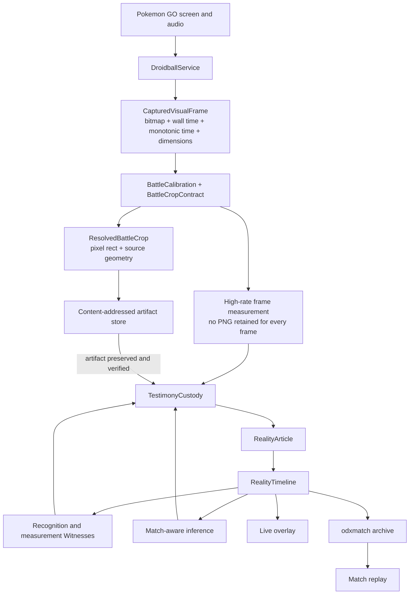

# Overdex Architecture Map

**Status:** Active architecture guide

**Verified against the working tree:** September 28, 2026

**Generated file inventory:** [CODEBASE_INDEX.md](CODEBASE_INDEX.md)

**Current feature gaps and roadmap review:** [Feature status](docs/reference/current-feature-status.md)
(October 20, 2026; includes Match Sight retirement).

**Terms and component navigation:** [Verified navigation index](docs/reference/overdex-navigation-index.md)
(code-checked October 12, 2026; includes the preserved supplied inventory and
corrections to its method names and responsibilities).

This document explains which systems currently carry Overdex at runtime and how
information moves between them. It is intentionally smaller than the complete
file inventory. The historical [PROJECT-MAP.md](PROJECT-MAP.md) remains preserved
as an earlier snapshot.

## Status labels

| Label | Meaning |
| --- | --- |
| **Canonical** | The current production path for this responsibility. New battle work should use it. |
| **Supporting** | Active code used by a canonical path, but not the owner of that responsibility. |
| **Legacy-active** | Still referenced at runtime or by an active feature. Do not remove it without migrating its callers. |
| **Debug** | Diagnostics, validation, or developer tooling. It is not the match record. |
| **Archive** | Preserved history or excavation material. It is intentionally outside the runtime architecture. |

## Architectural invariants

These rules are the stable boundary for new battle work:

1. A **Battle Region** is a spatial territory. A crop names what is being
   measured there. A Witness produces exactly one signal.
2. A captured crop becomes testimony only after its PNG bytes have been written
   and verified. `CropCaptured` carries an immutable repository-relative SHA-256
   reference, never an in-memory bitmap or an absolute path.
3. A persisted raw crop enters Custody and the Reality Timeline before formal
   recognition or inference consumes it. High-rate measurement paths may avoid
   retaining every frame, but their measurements, time, geometry, and Witness
   availability still enter the Timeline.
4. Wall time provides human/archive chronology. Monotonic time provides elapsed
   measurement. Frame arrival does not advance or pause the clock.
5. Witness availability is evidence. Until an operating record exists, the
   Timeline must not assume that a witness was observing.
6. A Droidball session surrounds zero or more battle attempts. A Match describes
   an actual battle record. Starting assistance does not make a Match active.
7. Replay may use later evidence to render what was present earlier, while
   retaining how and when that identity became known. It never rewrites the
   archived Articles.
8. Player combatants render on the left; opponent combatants render on the right.

## Runtime composition

The principal composition points are:

| Responsibility | Owner | Status |
| --- | --- | --- |
| Android navigation and ODX-Fi shell | [MainActivity.kt](app/src/main/java/com/example/overdex/MainActivity.kt) | **Canonical** |
| Observation-session construction and Witness registration | [PokedexViewModel.kt](app/src/main/java/com/example/overdex/ui/PokedexViewModel.kt) | **Canonical** |
| Screen and audio capture service | [DroidballService.kt](app/src/main/java/com/example/overdex/battle/observation/DroidballService.kt) | **Canonical** |
| Session lifecycle around a possible battle | [DroidballSession.kt](app/src/main/java/com/example/overdex/battle/observation/DroidballSession.kt) | **Canonical** |
| Match custody-to-Timeline publication and match-aware derivation | [Match.kt](app/src/main/java/com/example/overdex/battle/observation/Match.kt) | **Canonical** |
| Live overlay state | [DroidballOverlayPresentation.kt](app/src/main/java/com/example/overdex/battle/observation/DroidballOverlayPresentation.kt) | **Canonical presentation state** |

`PokedexViewModel` currently acts as the battle composition root. It creates the
Match and Droidball session, loads calibration, constructs artifact stores,
registers Witnesses, follows service signals, checkpoints the active Match, and
exports completed Matches.

## Canonical capture-to-Timeline flow



The decisive implementation files are:

- [CapturedVisualFrame.kt](app/src/main/java/com/example/overdex/model/observation/CapturedVisualFrame.kt) preserves capture time and frame geometry.
- [BattleCalibration.kt](app/src/main/java/com/example/overdex/data/BattleCalibration.kt) owns runtime calibrated Battle Regions.
- [MatchCalibrationProfileStore.kt](app/src/main/java/com/example/overdex/data/MatchCalibrationProfileStore.kt) owns named device profiles. Calibration stores update the selected profile before reporting a successful save; profile replacement is atomic. Loading preserves saved coordinates exactly, including positions that resemble historical defaults.
- [BattleCalibrationReferenceStore.kt](app/src/main/java/com/example/overdex/data/BattleCalibrationReferenceStore.kt) keeps one unaltered battlefield capture for Match Calibration. The preview labels device captures, user screenshots, and bundled references, and disables CRT distortion on this screen. Saved crop coordinates are not shifted to compensate for system bars.
- [BattleCropContract.kt](app/src/main/java/com/example/overdex/battle/observation/BattleCropContract.kt) resolves normalized regions into validated pixel rectangles and crop provenance.
- [BattleObservationContracts.kt](app/src/main/java/com/example/overdex/battle/observation/BattleObservationContracts.kt) names configured regions, crops, and single-output Witness contracts.
- [CropCaptureWitness.kt](app/src/main/java/com/example/overdex/battle/observation/CropCaptureWitness.kt) persists the crop before submitting `CropCaptured` testimony.
- [CropArtifactStore.kt](app/src/main/java/com/example/overdex/battle/artifact/CropArtifactStore.kt) implements `artifacts/crops/sha256/<digest>.png` identity and verification.
- [TestimonyCustody.kt](app/src/main/java/com/example/overdex/battle/custody/TestimonyCustody.kt) preserves testimony and source-availability records without dropping bursts.
- [RealityArticle.kt](app/src/main/java/com/example/overdex/battle/reality/RealityArticle.kt) is the immutable record envelope.
- [RealityTimeline.kt](app/src/main/java/com/example/overdex/battle/reality/RealityTimeline.kt) is the canonical Match ledger.

Failure to preserve an artifact means “crop not preserved.” No partial
`CropCaptured` testimony is accepted.

High-rate HP measurement is an explicit retention exception. The live HP
Witnesses may measure every usable frame without encoding every crop as PNG.
Their testimony retains the captured-frame time, calibrated geometry is fixed by
the crop contract, Witness availability records coverage, and sparse HP crops
remain available for forensic inspection. This keeps cadence measurable without
making an archive approach video size.

[DroidballObservationInput.kt](app/src/main/java/com/example/overdex/data/observation/DroidballObservationInput.kt)
yields after each delivered frame. A continuously busy crop must not monopolize a
bounded capture dispatcher and prevent countdown or resource crops from running.

## Session and Match lifecycle

```text
Droidball session
    deploy -> assistance armed -> calibration/team setup -> countdown
           -> battle active -> result -> armed for another Match -> ended

Battle Match
    MatchRecordStarted -> pre-GO evidence -> GO/accepted boundary
    -> live battle evidence -> MatchEnded -> archive/checkpoint
```

[DroidballSession.kt](app/src/main/java/com/example/overdex/battle/observation/DroidballSession.kt)
owns `ARMED`, `CALIBRATING`, `COUNTDOWN`, `BATTLE_ACTIVE`, `RESULT`, and
`ENDED`. [MatchState.kt](app/src/main/java/com/example/overdex/battle/observation/MatchState.kt)
describes the battle record itself. VS, countdown glyphs, announcements, active
species, and active type evidence may establish the battle surface and open the
HUD without pretending that the GO boundary was observed.

[MatchClock.kt](app/src/main/java/com/example/overdex/battle/observation/MatchClock.kt)
reads an independent monotonic authority. It is available before GO; captured
frames receive readings from that same authority.

GO remains the primary Match Start witness. If GO was missed,
[CountdownMatchStartInference.kt](app/src/main/java/com/example/overdex/battle/inference/CountdownMatchStartInference.kt)
can derive the predicted boundary from a witnessed 3/2/1 and later combat within
30 seconds. The derived article cites both observations; it does not fabricate a
GO sighting. Species names, full HP bars, and charged-button countdown shading
cannot confirm this fallback. Fast Move inference rejects evidence captured
before the accepted start even if delivered later.

## Recognition, measurement, and inference

### Species

- [PersistedSpeciesWitness.kt](app/src/main/java/com/example/overdex/battle/observation/PersistedSpeciesWitness.kt) is the formal persisted-crop species Witness. Its accepted result enters Custody and the Timeline.
- [LiveOverlaySpeciesPipeline.kt](app/src/main/java/com/example/overdex/battle/observation/LiveOverlaySpeciesPipeline.kt) owns the live active-badge OCR lane. It preserves its crop, waits for the corresponding Timeline article, then submits raw readings and accepted species testimony through Custody. At shared OCR admission it selects the newest preserved crop, skips already-confirmed checks, and records queue/native-read timing in `*_SPECIES_OVERLAY_PIPELINE_LATENCY` diagnostics. Superseded raw crop articles and source timestamps remain intact. The HUD and replay consume the same identity evidence.
- [SpeciesNameRecognizer.kt](app/src/main/java/com/example/overdex/data/observation/SpeciesNameRecognizer.kt) uses one urgent turn in the shared Latin reader for its bounded treatments. There is no separate player/opponent mutex ahead of that queue; the backend still processes one read at a time and retains bitmap ownership through cancellation.
- [PersistedAnnouncementSpeciesWitness.kt](app/src/main/java/com/example/overdex/battle/observation/PersistedAnnouncementSpeciesWitness.kt), team-roster testimony, and battle-cry candidates provide independent evidence that may support or refute identity.
- [SpeciesCheckCoordinator.kt](app/src/main/java/com/example/overdex/battle/observation/SpeciesCheckCoordinator.kt) schedules burst checks around cues rather than treating species OCR as a permanent high-rate workload.

[SpeciesBadgeTextLocator.kt](app/src/main/java/com/example/overdex/battle/observation/SpeciesBadgeTextLocator.kt)
can recover a nearby badge name row before OCR. It searches only within two
strip heights of the assigned location, preserving the assigned horizontal
column and strip size. It does not rewrite the saved calibration or establish
identity from color. Catalogue OCR still decides the species. Distinct failed
reads retain diagnostic crop references, including empty OCR output.

The capture service pauses visual publication while Overdex is visible and
clears the replayed source frame on return. A short transition guard prevents
queued instrument frames from becoming battle evidence. This is an own-app
visibility guard, not a claim that full-screen capture can identify every
other foreground package.

### HP cadence and moves

- [LiveActiveHpBarWitnesses.kt](app/src/main/java/com/example/overdex/battle/observation/LiveActiveHpBarWitnesses.kt) tracks active HP-bar geometry and live motion/border behavior.
- [PersistedActiveHpBarWitness.kt](app/src/main/java/com/example/overdex/battle/observation/PersistedActiveHpBarWitness.kt), [PersistedActiveHpBarCadenceWitness.kt](app/src/main/java/com/example/overdex/battle/observation/PersistedActiveHpBarCadenceWitness.kt), and [PersistedActiveHpBarBorderPulseWitness.kt](app/src/main/java/com/example/overdex/battle/observation/PersistedActiveHpBarBorderPulseWitness.kt) preserve separate measurements.
- [FastMoveCadenceInference.kt](app/src/main/java/com/example/overdex/battle/inference/FastMoveCadenceInference.kt) compares measured cadence with species move knowledge and publishes derived conclusions through the Match.
- An HP tick or border pulse on one side is evidence of the opposing combatant's Fast Move. The moving bar belongs to the Pokémon whose animation moves it.

Player shields have a dedicated crop and `PlayerShieldCountMeasured` testimony.
`PokemonFaintWitness` runs separately for each side using its own Poké Ball
counts. Delayed faint testimony remains attached to the departed species rather
than clearing its replacement's move identity.

Replay resource counts and per-combatant energy are reconstructed by
[ReplayTeamResources.kt](app/src/main/java/com/example/overdex/battle/replay/ReplayTeamResources.kt)
and [ReplayEnergyTrack.kt](app/src/main/java/com/example/overdex/battle/replay/ReplayEnergyTrack.kt).
Energy is a balance of recorded events, not proof that every attack or spend was
captured. See the [October 12 verification](docs/verification/2026-10-12-battle-hp-resources-energy.md).

### Match results

- `MatchOutcomeCaptureGate` in [BattleCaptureGates.kt](app/src/main/java/com/example/overdex/battle/observation/BattleCaptureGates.kt) opens a bounded result check when either team's last Pokémon has red HP, or a team has no remaining Poké Balls. The surviving team may still have reserves.
- HP visibility is tracked separately for each side. These cues only schedule observation; `YOU WIN` / `GOOD EFFORT` testimony still establishes the result.

### Audio

- `DroidballService` captures PCM. [CueCenteredPcmCollector.kt](app/src/main/java/com/example/overdex/battle/audio/CueCenteredPcmCollector.kt) retains eight seconds in memory and selects a 500 ms pre / 700 ms post window around the visual Article's source timestamp, including requests delivered late. The window's original wall and monotonic start times accompany its samples.
- [AudioCaptureWitness.kt](app/src/main/java/com/example/overdex/battle/audio/AudioCaptureWitness.kt) preserves requested WAV artifacts before publishing `AudioCaptured`, records unavailable-window diagnostics, and excludes cues from other Matches. Missing retained audio is not replaced by sound from delivery time.
- [PersistedBattleCryCandidateWitness.kt](app/src/main/java/com/example/overdex/battle/audio/PersistedBattleCryCandidateWitness.kt) preserves ranked cry candidates as evidence rather than silently promoting the strongest candidate to fact.
- [PreparedCryReferenceIndex.kt](app/src/main/java/com/example/overdex/battle/audio/PreparedCryReferenceIndex.kt) verifies and prepares bundled cry references once per app process, off the UI thread. Only reference features are reused; live audio is independently preserved and measured. `BattleCryListeningCue` excludes result music, QTE bubbles and attack effects from species matching and species-check triggers. `WavPcm16` decodes samples in bulk rather than allocating a buffer per sample. Its separate bundled-reference reader finalizes the known zero-length PCM export headers in a temporary copy, after asset verification; captured WAV testimony remains strict and source assets remain unchanged.
- [FastMoveSoundMeasurement.kt](app/src/main/java/com/example/overdex/battle/audio/FastMoveSoundMeasurement.kt) measures sound timing/type features that can corroborate visual cadence.

## Presentation

[BattleOverlay.kt](app/src/main/java/com/example/overdex/ui/components/BattleOverlay.kt)
renders the live Droidball HUD from presentation state. Presentation is allowed
to react quickly, but it is not the historical authority.

The HUD can show known species and possible moves before a specific move has
been identified. Hazard emphasis is derived from reference knowledge and the
player's active typing. Presentation decisions never alter captured testimony.

The battle HUD uses an 80%-opaque white surface with complementary upper corners
and the same width-scaled 27/415 corner radius at its lower edge. Saved HUD Y
continues to mean the badge's flat bottom seam; the corner tips extend above it
without rewriting the profile. The battle window is capturable rather than
`FLAG_SECURE` (which created a black rectangle in whole-screen recordings).
Registration/team editing retain their private-window/capture-pause behavior.
`CapturedVisualFrame.overlayRegion` describes the visible presentation footprint;
the active-species lane refuses name crops intersecting it so our own sprite-card
labels cannot confirm identity. Announcement inference still requires game phrases,
not isolated species/move names from the HUD. On-device tests can read retained
species/announcement pixels through the 80% background, but overlapping HUD ink
still obscures them; this is not proof of reliable live read-through.
Move labels use distinct violet ink while retaining full names, confirmation
checks, and red danger markers/percentages. The device probe also tries removing
violet from a derived OCR copy. It improved one overlap but still lost letters in
another, so color removal is an experiment, not a live evidence treatment. Raw
captures remain intact.
The October 13 geometry probe measured word bounding boxes in a common 672-pixel
capture space: GO announcement 28 px high, GO species 21 px, HUD moves 10–13 px,
and HUD species 13 px. These sampled heights seed the bounded, per-witness
[OcrHeightProfile](app/src/main/java/com/example/overdex/data/observation/OcrSourceFilter.kt).
The live badge/announcement readers retain word geometry and source-pixel color
measurements through [OcrWordGeometry](app/src/main/java/com/example/overdex/data/observation/OcrWordGeometry.kt),
undoing padding, threshold enlargement, and ML Kit's minimum input scaling.
Height alone never rejects a word: a rejection requires a smaller-than-expected
word, HUD-colored pixels, and intersection with the HUD footprint captured with
that frame. Profiles learn only from clear, catalogue-confirmed native-color readings and do
not rewrite calibration. The existing live species crop-overlap guard remains.
Original OCR text, word measurements, rejection reasons, and capture-time HUD
bounds survive archive serialization. Announcement consumers receive filtered
text citing its original reading and crop. Replay crop recognition applies the
same filter when footprint metadata exists; older archives remain readable.
No font-family classifier or letter reconstruction is claimed: a large partial
word is still partial, and HUD ink can still cover the needed game strokes.

Resolved opponent charged-move announcements also confirm the named move in
`DroidballOverlayPresentation`; two distinct confirmations leave only those two
charged moves visible, and confirmations survive switches within the Match.
Poké Ball counts require visible badge/slot pixels. A covered or blank crop is
unavailable evidence, not a zero-survivor count. Entry and faint cues open a brief
ball-check window so the first hidden frames do not exhaust the check.

## Owned cards and editing

[EditSpecimenScreen.kt](app/src/main/java/com/example/overdex/ui/screens/EditSpecimenScreen.kt)
edits the persistent owned card, including multiple named team memberships.
These names can be searched in the owned binder and selected in the saved-team
library. Assigning a name alone does not replace the active battle team; the
trainer explicitly chooses a lineup in pre-flight. Database migration 9 → 10 adds `teamsJson`
without recreating owned cards. [NicknameTokens.kt](app/src/main/java/com/example/overdex/model/NicknameTokens.kt)
keeps type symbols as portable text tokens, while `TypeIconText` renders them as
icons in the editor, binder LCD, and specimen detail view. The LCD keyboard and
instrument A button share the same number/type-page switch.

`BATTLE → BINDERS → Add or Edit Binders` opens
[BinderLibraryScreen.kt](app/src/main/java/com/example/overdex/ui/screens/BinderLibraryScreen.kt).
[OwnedBinderStore.kt](app/src/main/java/com/example/overdex/data/OwnedBinderStore.kt)
persists named filtered views in private `owned_binders` preferences. Rules include
CP range, standard Great/Ultra/Master presets, allowed/excluded types and species,
region, shadow, shiny and favorite status. League presets enforce their CP cap
and exclude temporary Mega/Primal forms; they are not a live seasonal-cup rules
service. Cup restrictions can be entered explicitly. Unknown required CP or
reference data does not pass a restriction. Cards retain one specimen ID across
all matching binders; changing their CP or status updates view membership.

[BattleTeamLibraryScreen.kt](app/src/main/java/com/example/overdex/ui/screens/BattleTeamLibraryScreen.kt)
is reachable from both Droidball pre-flight and the current-team editor. It saves
named three-member lineup snapshots alongside the existing active team in
`current_battle_team` preferences. It also resolves named owned-card memberships
from their current moves, requiring exactly three cards with valid move selections.
Choosing a team copies it into the active lineup; left/right select the lead.
Owned-card references remain attached to these members. Editing a saved snapshot's
active lineup does not silently replace the named snapshot: the library provides
an explicit replacement action. Card editing, lineup editing and selection return
within the pre-flight navigation stack. Named teams and complete owned-card teams are also listed directly in the
pre-flight LCD for one-action selection.

[FieldTeamEditor.kt](app/src/main/java/com/example/overdex/battle/team/FieldTeamEditor.kt)
and [FieldTeamEditorOverlay.kt](app/src/main/java/com/example/overdex/ui/components/FieldTeamEditorOverlay.kt)
let the user correct species and choose moves without leaving Pokémon GO. Before
GO, Droidball keeps TEAM / MOVES and SCAN TEAM SELECT available even with a configured
team or an already-open HUD. Rescanning restarts the one-shot Team Select witnesses.
Confirming the scanned roster opens an unsaved move-selection draft; partial scans
can be corrected through TEAM / MOVES. USE THIS TEAM persists the active lineup and
submits fresh `PlayerTeamSlotConfigured` articles. Explicitly loaded saved teams keep
owned-card IDs; species scans alone never assign those IDs or assume moves. An accepted Match start closes
the draft. The secure field editor pauses visual frame publication while open and
allows a short compositor settling interval after close. While open, the editor keeps touch input away from GO; USE THIS TEAM or CLOSE resumes the game. It does not change crop calibration.

Manual registration step 1 filters its paged species search by region (including
Hisui), using National Dex ranges so older imported region labels cannot hide
entries. Left/right change region, up/down browse, and holding up/down accelerates
until release. The viewport keeps one row ahead for taps and three during a hold,
in the direction of travel, except at the ends of the list. START, SELECT and the
stepped END key release keyboard focus while keeping its keys visible in this
search; tapping a key or START/SELECT resumes typing. B still hides the keyboard.
Other keyboard workflows retain their existing close-on-finish behavior. The
comma has moved to the number/type page.

The owned binder's `+` opens [GuidedRegistrationScreen.kt](app/src/main/java/com/example/overdex/ui/screens/GuidedRegistrationScreen.kt),
with a manual-entry alternative. Its scan uses a separate `DroidballService`
registration mode: requested field reads capped at about two source frames per second, one shared OCR reader,
no battle witnesses, microphone, or Match archive. `RegistrationFieldReader` reads
the requested field; `DetailPageReader` remains the semantic reader for explicitly
reviewed full screenshots. User confirmation accepts the field without inventing a second frame. The current GO game-master family links
augment older Pokédex evolution links; candy identifies a family, not a specimen's
species. Ambiguous nicknames offer species selection.

[RegistrationDraft.kt](app/src/main/java/com/example/overdex/data/registration/RegistrationDraft.kt)
retains fields across scrolling. Once identity, CP and move-list evidence is complete,
`SAVE CARD` saves one stable owned-card ID. A saved scan freezes until the user
starts the next card. Changed live name/CP/candy readings offer a correction or a
new Pokémon. NEXT POKÉMON is also available before completing a card, retaining
its unfinished draft internally. Conflicting whole-page CP/name readings still
pause a scan to prevent mixing specimens. A name from a different candy family
requires correction or explicit species confirmation before saving. Private `files/registration/` JSON stores recoverable drafts and field
readings with timestamps/source rectangles, without retaining frame PNGs. The
scan pauses reading while Overdex is visible. Choose Pokémon GO in Android's
capture picker. Shadow text is supported; shiny/IV appraisal and sprite-only
evolution recognition are not implemented by this reader. Real scrolling-page
acceptance remains separate from unit and recorded-screenshot OCR checks.

`SCREENSHOTS / DRAGGY BOXES` in guided registration opens
[RegistrationCalibrationScreen.kt](app/src/main/java/com/example/overdex/ui/screens/RegistrationCalibrationScreen.kt).
This recovers the screenshot workflow introduced in `5e4b8437` and removed in
`71f19ee8`, using the surviving `CaptureTemplateManager` and overlay rather than
restoring the retired observation pipeline. The CRT displays a fitted screenshot
with a thin box; the LCD drag area and D-pad adjust source-pixel coordinates.
A advances boxes, SELECT changes move/size, and START saves all box positions
with source dimensions/device metadata. Registration now has **one detail layout**.
The old Summary/Move entry points resolve to it; old keys remain readable and are
not removed. `FastMoveRow` takes priority over the obsolete `SummaryFastMove` alias.

Live registration shows all field boxes. Scroll GO between the boxes until the
wanted field fits, then tap that box. `RegistrationScreenshotReader.readField`
reads only the requested crop; `RegistrationFieldReader` interprets its declared
role without requiring unrelated anchors to be simultaneously visible. Guides
and the control panel disappear before a fresh frame is admitted to OCR. The
result requires confirmation; stale/cancelled requests cannot enter another card.
Guides stay hidden while reviewing a field and restore below the control panel,
so overlapping boxes cannot intercept panel buttons.
`PROGRESS → ADJUST BOXES → SAVE BOXES` adjusts the same normalized layout used by
screenshots. Fast and both charged moves have separate boxes. HP and move-heading
boxes record anchors, while icon-only fields ask for explicit user confirmation.

Screenshot `READ THIS BOX` uses that same field reader. Full screenshot reading
remains an explicit, separately reviewed semantic scan. Confirmed fields accumulate
in one durable UUID draft; corrections supersede old values while retaining their
readings. `SAVE CARD` is explicit so optional fields can be collected before saving.
No automatic layout training or visual icon classifier is claimed.

Registration's optional `LISTEN FOR CRY` captures five seconds of GO-only internal
playback after an explicit tap. It uses the existing local energy-envelope matcher to
offer candidates, never auto-confirms one. The user confirms a candidate; the durable
draft retains candidate/reference hashes and the user's confirmation, not PCM files.
Silent/unavailable capture leaves manual species selection available. Music off and
sound effects on help isolate the cry; matching accuracy still needs live testing.

## Individual Pokémon battle records

`OwnedPokemon.id` remains the permanent card identity. Size is a distinct
`PokemonSize` label (unknown/XXS/XS/average/XL/XXL), not Candy XL or inferred level.
Room migration 10→11 adds the label without replacing cards. Registration reads a
positive height-size badge separately from Candy XL; the card editor can set/correct it.

Configured teams created from owned cards carry an `OwnedPokemonBattleSnapshot`
into `PlayerTeamSlotConfigured` and its archive DTO. It freezes card ID, species,
nickname, CP, shadow/purified/shiny flags and size for that match; configured moves
already live in that same testimony. Later card edits cannot relabel old matches.
Old archives remain readable but an unlinked species name cannot identify a specimen.

`battle.history.BattleRecordProjector` derives appearances, supported canonical Fast
Move uses, named charged moves, player faints and supported knockout credits from
archived Timeline articles. It excludes pre-start/post-result uses and motion-only
guesses, preserves source article IDs, and leaves duplicate-species card attribution
unresolved. A knockout credit requires a witnessed opponent faint and a recent player
hit against that same opponent with no intervening identity change (three-second
window). This is labelled inference, not a new raw observation; other opponent faints
remain uncredited. Missing observations cannot support exact lifetime totals.

`BattleRecordStore` saves rebuildable indexes in private `files/battle_records/`, keyed
by match ID so compact/full copies do not add duplicate totals. It reads Timeline JSON
with artifact references only, never loads PNGs for statistics, and can rebuild indexes
from internal archives. `BATTLE → Records` and a card's `[A] BATTLE RECORDS` expose
species, opponent, move, event, shadow and size filters plus W/L/T/unknown outcomes.
Selecting an event opens replay two seconds before its timestamp. Natural-language
search and automatic stitched compilations remain future consumers of this index.

## Archive and replay

- [MatchArchivePackageWriter.kt](app/src/main/java/com/example/overdex/battle/archive/MatchArchivePackageWriter.kt) writes manifest, Timeline, and selected artifacts.
- [MatchArchivePackageReader.kt](app/src/main/java/com/example/overdex/battle/archive/MatchArchivePackageReader.kt) validates archive structure, size, hashes, and portable artifact references.
- [MatchArchiveArticleSelector.kt](app/src/main/java/com/example/overdex/battle/archive/MatchArchiveArticleSelector.kt) distinguishes compact and forensic article selection.
- [RealityArticleArchiveMapper.kt](app/src/main/java/com/example/overdex/battle/archive/RealityArticleArchiveMapper.kt) maps live immutable Articles into portable archive payloads.
- [MatchReplayModel.kt](app/src/main/java/com/example/overdex/battle/replay/MatchReplayModel.kt) buffers the complete archive and projects it into replay scenes. It can use evidence learned later to identify earlier visible combatants while exposing that reconstruction basis.
- [ReplayHpTrack.kt](app/src/main/java/com/example/overdex/battle/replay/ReplayHpTrack.kt) projects measured HP, damage trails, and border pulses for each combatant's appearance. First entries display full HP as an explicit presentation assumption until a valid measurement; returning species retain earlier HP rather than healing. Pre-GO samples and implausibly thick bar shapes cannot poison the opening HP baseline. The archive remains unchanged. Replay's LCD event-blip toggle persists independently of its transport sounds.
- [ArchivedSpeciesCropRecognizer.kt](app/src/main/java/com/example/overdex/battle/replay/ArchivedSpeciesCropRecognizer.kt) can recover identity from preserved archive crops without modifying the archive.
- [ReplayEditorScreen.kt](app/src/main/java/com/example/overdex/ui/screens/observatory/ReplayEditorScreen.kt) supplies the clip library and compilation editor under **Battle → Match → Replay Editor**. Replay's LCD can mark exact start/end times, name a clip, and add notes. Compilation order is editable using the physical buttons or long-press dragging in the LCD.
- [ReplayExcerptStore.kt](app/src/main/java/com/example/overdex/battle/replay/ReplayExcerptStore.kt) retains named interval references in `files/replay_excerpts/`, deduplicated GZIP Timeline snapshots in `files/replay_sources/`, and separate compilation documents in `files/replay_compilations/`. Snapshots preserve the complete source Timeline, including pre-clip state and later identity evidence; they contain no PNG/WAV files. Recovered species presentation stays separate from raw articles. Legacy reference-only clips protect their source match from the newest-50 cleanup until a snapshot is recovered.
- [ReplayCompilation.kt](app/src/main/java/com/example/overdex/battle/replay/ReplayCompilation.kt) defines editorial ordering and bounded playback windows. Compilation playback uses each source's original clock and never creates a Match or changes battle statistics. Event-search supercuts, event-specific coaching annotations, and video export remain future work.

Each Match has its own ID, Timeline, archive source, and replay projection.

Active recovery saves use [MatchCheckpointJournal.kt](app/src/main/java/com/example/overdex/battle/archive/MatchCheckpointJournal.kt):
every 15 seconds only newly appended Articles are serialized, checksummed and
synced to `files/match_archives/active-<match-id>.odxjournal`. Referenced source
artifacts are already durable in the content-addressed store. On process restart,
`OverdexApplication` snapshots the old checkpoints before a new session starts,
then `ArchiveDirectoryManager` recovers them on an I/O worker into ordinary compact
`.odxmatch.zip` files. Torn tails and corrupt journals are retained for diagnosis;
older `active-*.odxmatch.zip` checkpoints still recover. Normal completed-match
exports remain ZIPs. PNG entries avoid a second compression pass while retaining
the same integrity checks. See the [October 15 performance validation](docs/verification/2026-10-15-performance-optimization.json)
for measured device timings and the remaining live-battle boundary.

`MatchSummaryRoute` / `MatchSummaryScreen` now summarize this same canonical ledger.
The screen uses the current in-process Match when present and loads the newest
internal archive after process recreation, using references-only archive reads.
`MatchArchiveSource.snapshot()` selects only that Match ID from the shared ledger;
unassigned session articles and other Matches remain in the ledger without entering
the summary/export or weakening the strict archive mapper.
Its CRT content scrolls with Up/Down; Left/Right select LCD actions and A activates
them. Compact export remains available for loaded saved matches; full forensic
export is offered when the complete in-process ledger is available.
The old `ObservationRecorder` / `MatchRecording` summary is no longer this route's
data source. Archive Article Details is also in the physical action cycle.


## Trainer Comms

`Profile → Trainer Comms` now routes to `TrainerCommsScreen`. `TrainerCommsServices`
uses Firebase Authentication accounts; `CommsRepository` owns per-account
conversation history, drafts, and the durable send queue. `FirebaseCommsBackend`
reads/writes `trainerCommsProfiles`, `trainerCommsCodes`, and `trainerConversations`
with immutable message subcollections. `firestore.rules` requires account access,
explicit membership, and validated sender identity.

The public discovery handle is a twelve-digit Pokemon GO trainer code. Stable
account IDs, not those rerollable codes or local trainer UUIDs, own conversations.
Account email/password never enter public profile/message documents. The code is
self-reported, not proof of Pokemon GO account ownership.

Direct conversations have deterministic account-pair IDs; groups have persistent
UUIDs and 2–8 members. Group membership is immutable in this first release.
Pending writes become sent only after a server acknowledgement. Failed retries
reuse the original message ID. The legacy global local chat preferences are kept
and exposed as read-only history without inventing old recipients/delivery.

The former `ChatScreen`/`SharedPreferencesChatRepository`/`FirebaseChatTransport`
remain source-only legacy components; MainActivity no longer starts or routes
those transports. Match/clip attachments and member-management controls are not
implemented yet. See the [sharing plan](docs/plans/trainer-comms-sharing.md).

## Parallel and legacy systems

These names overlap with the canonical Match pipeline but do not mean the same
thing:

| System | Current status | Boundary |
| --- | --- | --- |
| `battle.reality.RealityTimeline` | **Canonical** | Immutable Article ledger used by current Match archives and replay. |
| `battle.timeline.BattleTimeline` | **Debug/legacy-active** | Used by verification, tests, and the old pipeline demo; it is not the current Match archive ledger. |
| `model.BattleTimeline` | **Legacy-active** | Used by the earlier `BattleMemory` path. |
| `SharedTimelineRepository` and `SharedTimelineScreen` | **Legacy-active; sharing moves to Trainer Comms** | Still reachable by current UI wiring. New match/clip sharing, groups, coaching, and future tournament coordination belong in Profile → Trainer Comms; see the [sharing plan](docs/plans/trainer-comms-sharing.md). Keep it separate from Match recording. |
| `model.Observation` | **Legacy-active** | Raw crop object used by `ObservationExtractor`; not a Battle Region or current RealityArticle. |
| `model.observation.Observation` | **Legacy-active/supporting** | Used by registration, general observation inputs, and older Witnesses. |
| `battle.observation.Observation` | **Supporting/debug** | Used by the battle workspace, debug factories, and verification paths. |
| `battle.debug.observatory.MatchRecording` | **Debug/legacy-active** | Debug recorder and legacy components remain; Match Summary no longer reads this model. It is not an `.odxmatch` archive. |
| `CaptureRegion` and `ObservationRegion` | **Non-battle legacy-active** | Existing callers may remain, but new battle geography uses `BattleCalibration`, `BattleRegionId`, and `BattleCropContract`. |

Do not remove a legacy-active system merely because a canonical replacement
exists. Migrate or retire its callers first. The reviewed cleanup state is kept
in [UNFINISHED_CODE_INVENTORY.md](UNFINISHED_CODE_INVENTORY.md).

## Known implementation boundary gaps

- The conceptual Droidball assistance session may span multiple Matches. The
  current implementation constructs a new `DroidballSession` beside each new
  `Match` while the capture service remains running. The service/deployment
  state currently represents the longer-lived assistance boundary.
- Several retired or superseded families remain active through callers. Their
  status is recorded above and in the unfinished-code inventory so that name
  overlap is not mistaken for shared ownership.

## Archive material

[`DexDox/Archive Dox/`](<DexDox/Archive Dox/>) and
[`DexDox/Ontology(old).md`](DexDox/Ontology%28old%29.md) preserve project history.
They are excluded from the runtime architecture and are not cleanup targets by
default.

## Keeping this map current

Update this narrative only when an ownership boundary or canonical runtime flow
changes. File additions and removals belong in the generated index:

```bash
./tools/generate-codebase-index.sh
```

That separation lets the architecture remain readable while the complete file
inventory follows infrastructure changes automatically.
