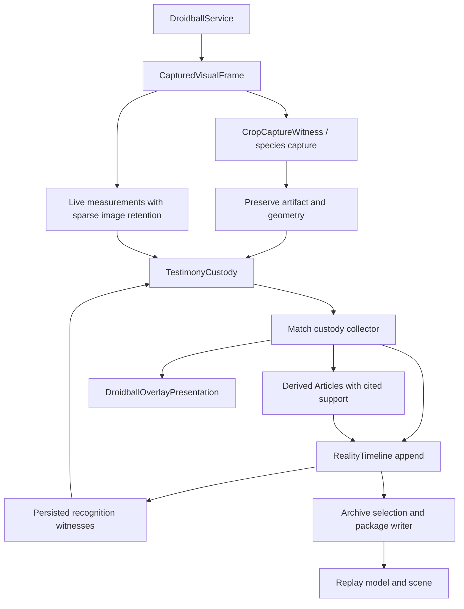

# Overdex terms and component navigation

Checked against the working tree on **October 12, 2026**. This is a task-oriented
index, not an exhaustive inventory or a declaration that every path works in live
battles. Recheck callers when changing a component.

The supplied [terminology inventory](overdex-terms-and-component-inventory.source.md)
is preserved unchanged as source material. This index corrects its method names
and ownership descriptions. Use [PROJECT-MAP-v2.md](../../PROJECT-MAP-v2.md) for
architecture and [UNFINISHED_CODE_INVENTORY.md](../../UNFINISHED_CODE_INVENTORY.md)
for the advisory work inventory. Source documents do not authorize new work.

## Terms and boundaries

| Term | Meaning and boundary | Code |
| --- | --- | --- |
| Captured frame | Bitmap, capture wall time, monotonic time, and source dimensions. A display's application-area dimensions are not necessarily its capture dimensions. | [CapturedVisualFrame](../../app/src/main/java/com/example/overdex/model/observation/CapturedVisualFrame.kt) |
| Battle Region | Calibrated normalized territory on the source image. | [BattleCalibration](../../app/src/main/java/com/example/overdex/data/BattleCalibration.kt) |
| Crop contract / resolved crop | Named measurement area, resolved into a pixel rectangle, bitmap, and source geometry. Resolution alone does not preserve an artifact or perform OCR. | [BattleCropContract](../../app/src/main/java/com/example/overdex/battle/observation/BattleCropContract.kt), [BattleObservationContracts](../../app/src/main/java/com/example/overdex/battle/observation/BattleObservationContracts.kt) |
| Witness | Observer responsible for one signal. This is a design responsibility, not proof that every class emits exactly one payload type: some retain raw OCR alongside a typed conclusion. | [Observer](../../app/src/main/java/com/example/overdex/battle/observation/Observer.kt) |
| Testimony / Custody | Testimony records and witness availability enter a thread-safe history and stream. Artifact references belong to relevant payloads; not every testimony has a bitmap or digest. Custody does not itself encode or verify PNGs. | [TestimonyRecord](../../app/src/main/java/com/example/overdex/battle/custody/TestimonyRecord.kt), [TestimonyCustody](../../app/src/main/java/com/example/overdex/battle/custody/TestimonyCustody.kt) |
| Reality Article | Immutable envelope carrying an observed or derived payload, timing, source, and evidence links. | [RealityArticle](../../app/src/main/java/com/example/overdex/battle/reality/RealityArticle.kt) |
| Reality Timeline | Canonical append-order ledger. Delayed observations can arrive out of capture-time order. It neither sorts everything chronologically nor computes the whole battle state. | [RealityTimeline](../../app/src/main/java/com/example/overdex/battle/reality/RealityTimeline.kt) |
| Match | One recording, including pre-start evidence. Its custody collector publishes Articles and runs downstream derivations. `MatchRecordStarted` is distinct from `MatchStarted`. | [Match](../../app/src/main/java/com/example/overdex/battle/observation/Match.kt) |
| Droidball session / service | Session coordinates assistance and battle phases; the Android service owns MediaProjection, audio capture, and overlay windows. A service can remain running across separate Match records. | [DroidballSession](../../app/src/main/java/com/example/overdex/battle/observation/DroidballSession.kt), [DroidballService](../../app/src/main/java/com/example/overdex/battle/observation/DroidballService.kt) |
| Specimen / owned Pokémon | One owned individual with a persistent ID, editable attributes, and team memberships. Species identity alone cannot distinguish two owned Charizard. | [OwnedPokemon](../../app/src/main/java/com/example/overdex/model/OwnedPokemon.kt), [OwnedPokemonEntity](../../app/src/main/java/com/example/overdex/data/local/OwnedPokemonEntity.kt) |
| Match archive model / package | `MatchArchive` is the serialized schema, Match ID, and Articles. The ZIP additionally has a manifest and selected referenced artifacts. It need not represent a completed battle. | [MatchArchive](../../app/src/main/java/com/example/overdex/battle/archive/MatchArchive.kt), [MatchArchiveExporter](../../app/src/main/java/com/example/overdex/battle/archive/MatchArchiveExporter.kt) |
| ODX-Fi, CRT, LCD, GlassShield | Shared instrument shell. CRT shows the scene; LCD and hardware controls provide contextual interaction. The Directory Tree's default LCD previews existing species-name, HP, Poké Ball, and announcement crop images with their last-capture time; contextual controls retain priority. GlassShield blocks CRT touch, not visibility. | [ODXFiShell](../../app/src/main/java/com/example/overdex/ui/ODXFi/ODXFiShell.kt), [MainActivity](../../app/src/main/java/com/example/overdex/MainActivity.kt), [DirectoryCropPreviewLcd](../../app/src/main/java/com/example/overdex/ui/components/DirectoryCropPreviewLcd.kt) |

## Navigate by the problem

| Problem or task | Start here | Trace next |
| --- | --- | --- |
| Start/Stop, service return, missing recording | [PokedexViewModel](../../app/src/main/java/com/example/overdex/ui/PokedexViewModel.kt) | `startObservation`, permission transition, `deployInstrument`, `startFreshMatch`; then Droidball service/session and archive checkpoint callers. |
| Species absent or late in HUD | [LiveOverlaySpeciesPipeline](../../app/src/main/java/com/example/overdex/battle/observation/LiveOverlaySpeciesPipeline.kt), [SpeciesCheckCoordinator](../../app/src/main/java/com/example/overdex/battle/observation/SpeciesCheckCoordinator.kt) | Check the preserved strip, raw OCR, accepted side/species, capture-to-publication delay, and Match's presentation update. The live pipeline contributes testimony; it is not presentation-only. |
| Badge OCR versus announcement/cry identity | [PersistedSpeciesWitness](../../app/src/main/java/com/example/overdex/battle/observation/PersistedSpeciesWitness.kt), [PersistedAnnouncementSpeciesWitness](../../app/src/main/java/com/example/overdex/battle/observation/PersistedAnnouncementSpeciesWitness.kt), [DecisiveBattleCrySpeciesWitness](../../app/src/main/java/com/example/overdex/battle/observation/DecisiveBattleCrySpeciesWitness.kt) | [SpeciesTextResolver](../../app/src/main/java/com/example/overdex/battle/observation/SpeciesTextResolver.kt), [SpeciesBadgeTextLocator](../../app/src/main/java/com/example/overdex/battle/observation/SpeciesBadgeTextLocator.kt), [TeamRosterSpeciesAttributor](../../app/src/main/java/com/example/overdex/battle/observation/TeamRosterSpeciesAttributor.kt). Registration with a witness ID in the composition root determines which implementation is active. |
| Pokémon or move assigned to the wrong team | [PersistedPlayerEntrySpeciesWitness](../../app/src/main/java/com/example/overdex/battle/observation/PersistedPlayerEntrySpeciesWitness.kt), Match, [TeamRosterSpeciesAttributor](../../app/src/main/java/com/example/overdex/battle/observation/TeamRosterSpeciesAttributor.kt) | Independent badge sides outrank saved-team membership. Exclusion needs three witnessed Team Select slots; an unscanned saved team cannot establish the active lead. Pending entries retain original times and cite later badge confirmation. [ReplaySpeciesAttribution](../../app/src/main/java/com/example/overdex/battle/replay/ReplaySpeciesAttribution.kt) corrects supported historical entry assignments without altering the archive. |
| Wrong or moving calibration box | [MatchCalibrationProfileStore](../../app/src/main/java/com/example/overdex/data/MatchCalibrationProfileStore.kt), [MatchCalibrationScreen](../../app/src/main/java/com/example/overdex/ui/screens/MatchCalibrationScreen.kt) | [BattleCalibrationReferenceStore](../../app/src/main/java/com/example/overdex/data/BattleCalibrationReferenceStore.kt), crop contract, saved normalized geometry, actual source dimensions, and reference-image origin. Do not compensate for system bars by silently shifting saved coordinates. |
| Missing HP, border pulses, damage, or visual samples | [LiveActiveHpBarWitnesses](../../app/src/main/java/com/example/overdex/battle/observation/LiveActiveHpBarWitnesses.kt) | `ActiveHpBarTracker`, `ActiveHpBarGeometry`, and `ActiveHpBarMeasurer` live in [PersistedActiveHpBarWitness.kt](../../app/src/main/java/com/example/overdex/battle/observation/PersistedActiveHpBarWitness.kt). Inspect both endcaps and the complete movement range on source frames. The locator recovers white outlines against white Pokémon art and accepts blue as well as orange border flashes; a flash is evidence for the recipient's attacker, not a move-type classification. |
| Fast Move count or duplication | [FastMoveUseInference](../../app/src/main/java/com/example/overdex/battle/inference/FastMoveUseInference.kt), [FastMoveUseEvidence](../../app/src/main/java/com/example/overdex/battle/inference/FastMoveUseEvidence.kt) | Individually timed evidence, side attribution, witnessed start or measured-combat fallback, merging, delayed charged-phase boundaries, switches, and faints. Recipient HP damage/pulse describes the opposite side's attack; vertical bar motion describes its own combatant. |
| Fast Move name or surviving candidate list | [FastMoveCadenceInference](../../app/src/main/java/com/example/overdex/battle/inference/FastMoveCadenceInference.kt) | Cadence, effectiveness testimony, known species/moves, and identification basis. [ChargedMoveEffectivenessWindow](../../app/src/main/java/com/example/overdex/battle/inference/ChargedMoveEffectivenessWindow.kt) excludes lingering charged-impact text from fast-move identification; it does not suppress hit measurements. An unclassified sound or visual pulse does not establish a move type. A provisional hypothesis is not a confirmed move. |
| Energy gains or spending | [FastMoveEnergyInference](../../app/src/main/java/com/example/overdex/battle/inference/FastMoveEnergyInference.kt), [ChargedMoveAnnouncementInference](../../app/src/main/java/com/example/overdex/battle/inference/ChargedMoveAnnouncementInference.kt) | Gains require individually accepted uses and an eligible move-identity basis. Charged-move inference consumes announcement OCR; it does not OCR pixels itself. [ReplayEnergyTrack](../../app/src/main/java/com/example/overdex/battle/replay/ReplayEnergyTrack.kt) projects per-combatant recorded energy, not guaranteed actual energy. |
| Balls, shields, or a missed faint | [BattleCaptureGates](../../app/src/main/java/com/example/overdex/battle/observation/BattleCaptureGates.kt), [PersistedOpponentBattleResourceWitness](../../app/src/main/java/com/example/overdex/battle/observation/PersistedOpponentBattleResourceWitness.kt), `PersistedPlayerPokeBallWitness` in the same file | The historical opponent-resource filename also contains the player-ball witness and player-shield factory. It does not measure switch timers. [OpponentPokemonFaintWitness.kt](../../app/src/main/java/com/example/overdex/battle/observation/OpponentPokemonFaintWitness.kt) contains the both-sides `PokemonFaintWitness` and count-based tracker. |
| Match start or result missing | [CountdownMatchStartInference](../../app/src/main/java/com/example/overdex/battle/inference/CountdownMatchStartInference.kt), Match, BattleCaptureGates | Distinguish witnessed GO, inferred countdown-plus-combat start, independent timer support, an enabled outcome crop, and accepted result text. Ball counts/red HP open checks; they do not themselves declare a winner. |
| QTE Nice/Great/Excellent | [ChargeMoveQteVibrationInference](../../app/src/main/java/com/example/overdex/battle/inference/ChargeMoveQteVibrationInference.kt) | Short `DeviceMotionPulseMeasured` events plus visible charge cues. These are motion-based inferences, not direct accessibility vibration callbacks. |
| Live QTE type-icon calibration | [LiveQteCalibrationWindow](../../app/src/main/java/com/example/overdex/ui/components/LiveQteCalibrationWindow.kt), [MatchCalibrationScreen](../../app/src/main/java/com/example/overdex/ui/screens/MatchCalibrationScreen.kt) | HUD **QTE BOX** opens a touch-through guide with Move/Size editing. Both editors save `BattleCalibration.qteTypeIconsRegion`. `QteTypeIconSampling` opens a bounded 8 Hz raw-crop window on Get Ready or **SAMPLE 10s**, using the visible draft/current saved region. Samples retain original times and coordinates in compact/full archives. No moving-glyph type classifier is enabled yet. |
| Species/moves/faint marks in the live HUD | [DroidballOverlayPresentation](../../app/src/main/java/com/example/overdex/battle/observation/DroidballOverlayPresentation.kt), [BattleOverlay](../../app/src/main/java/com/example/overdex/ui/components/BattleOverlay.kt) | Opponent slots, active identity, confirmed/possible moves, weaknesses, and faint state. Do not assume this presenter exposes HP/energy just because replay does. |
| Replay identity, HP, energy, resources, or timing | [MatchReplayModel](../../app/src/main/java/com/example/overdex/battle/replay/MatchReplayModel.kt), [MatchReplayScreen](../../app/src/main/java/com/example/overdex/ui/screens/observatory/MatchReplayScreen.kt) | [ReplayHpTrack](../../app/src/main/java/com/example/overdex/battle/replay/ReplayHpTrack.kt), ReplayEnergyTrack, [ReplayTeamResources](../../app/src/main/java/com/example/overdex/battle/replay/ReplayTeamResources.kt), [ReplayPlaybackClock](../../app/src/main/java/com/example/overdex/battle/replay/ReplayPlaybackClock.kt), [ArchivedSpeciesCropRecognizer](../../app/src/main/java/com/example/overdex/battle/replay/ArchivedSpeciesCropRecognizer.kt). Later evidence may reconstruct earlier identity without rewriting Articles. |
| Match Summary empty or unreachable | [MatchSummaryScreen](../../app/src/main/java/com/example/overdex/ui/screens/observatory/MatchSummaryScreen.kt), [MatchSummary](../../app/src/main/java/com/example/overdex/battle/archive/MatchSummary.kt) | Canonical current ledger or newest saved internal archive. Up/Down scroll CRT, Left/Right choose LCD actions, A activates, B returns. References-only loading; no PNG decoding. |
| Archive size, missing image, or import failure | [MatchArchiveExporter](../../app/src/main/java/com/example/overdex/battle/archive/MatchArchiveExporter.kt), [MatchArchiveArticleSelector](../../app/src/main/java/com/example/overdex/battle/archive/MatchArchiveArticleSelector.kt) | [MatchArchivePackageWriter](../../app/src/main/java/com/example/overdex/battle/archive/MatchArchivePackageWriter.kt), [MatchArchivePackageReader](../../app/src/main/java/com/example/overdex/battle/archive/MatchArchivePackageReader.kt), [RealityArticleArchiveMapper](../../app/src/main/java/com/example/overdex/battle/archive/RealityArticleArchiveMapper.kt). Compact removes uncited raw crop/audio Articles, except the bounded QTE calibration samples; a missing image alone does not prove absent capture. |
| Frame rate, scheduling, sparse PNG retention | [LiveCaptureSamplingPolicy](../../app/src/main/java/com/example/overdex/battle/observation/LiveCaptureSamplingPolicy.kt), [DroidballObservationInput](../../app/src/main/java/com/example/overdex/data/observation/DroidballObservationInput.kt) | Live HP frames versus sparse CropCaptureWitness work, bitmap ownership, source time, availability and [CropArtifactStore](../../app/src/main/java/com/example/overdex/battle/artifact/CropArtifactStore.kt). Full-frame artifacts and crop provenance can be shared; artifact count is not a measurement-rate counter. |
| Binders, shared card identity, preflight teams | [OwnedBinderStore](../../app/src/main/java/com/example/overdex/data/OwnedBinderStore.kt), [MyCollectionViewModel](../../app/src/main/java/com/example/overdex/ui/MyCollectionViewModel.kt) | [CurrentBattleTeam.kt](../../app/src/main/java/com/example/overdex/battle/team/CurrentBattleTeam.kt) contains `CurrentBattleTeamStore` and saved teams; [OwnedBattleTeam.kt](../../app/src/main/java/com/example/overdex/battle/team/OwnedBattleTeam.kt) resolves named memberships from current owned cards. MyCollectionViewModel is not the sole owner of all binder/team state. |
| Add an owned card in the Directory Tree | [DirectoryOwnedPokemonEditor](../../app/src/main/java/com/example/overdex/ui/screens/DirectoryOwnedPokemonEditor.kt), [OwnedPokemonDraft](../../app/src/main/java/com/example/overdex/model/OwnedPokemonDraft.kt) | `BATTLE → Add Pokémon` expands editable fields in the existing tree. The shared LCD handles text entry and move details. `MyCollectionViewModel.createOwnedPokemon(...)` completes the insert before the draft is cleared; team memberships share the card's individual ID. This manual path does not start assisted capture. |
| Assisted registration, when resumed | [GuidedRegistrationController](../../app/src/main/java/com/example/overdex/data/registration/GuidedRegistrationController.kt), [RegistrationScreenshotReader](../../app/src/main/java/com/example/overdex/data/registration/RegistrationScreenshotReader.kt) | [RegistrationDraft](../../app/src/main/java/com/example/overdex/data/registration/RegistrationDraft.kt), [CaptureTemplateManager](../../app/src/main/java/com/example/overdex/CaptureTemplateManager.kt). The separate observation-based path uses [RegistrationEngine](../../app/src/main/java/com/example/overdex/data/observation/RegistrationEngine.kt) and [RegistrationSession](../../app/src/main/java/com/example/overdex/model/RegistrationSession.kt). Their existence does not imply one unified registration pipeline. |

## Publication and storage path



The diagram shows responsibilities, not coroutine ordering. Artifact persistence
precedes `CropCaptured` testimony. Some inferences are appended directly by Match;
do not assume that every derived Article re-enters Custody.

## Real entry points instead of approximate method names

| Entry point | What it actually does |
| --- | --- |
| `PokedexViewModel.startObservation()` | Requests the observation permission phase; does not itself start MediaProjection. Follow `onPermissionsGranted()` and `deployInstrument(...)` to private `startFreshMatch(...)`. |
| Match's `custody.testimonyFlow.collect` | Converts custody records into Articles and publishes/derives downstream state. There is no `Match.publish(...)` API. |
| `CropArtifactStore.preservePng(...)`, `preserveFrameCrop(...)` | Persist a crop or a shared source frame. `FileCropArtifactStore` also provides `preserveEncodedPng(...)`, `preserveEncodedFramePng(...)`, and `loadVerifiedPng(...)`. There is no `record(...)` method here. |
| `BattleCropContract.resolve(...)` | Resolves a named crop against calibrated source geometry. |
| `FastMoveUseInference.accept(...)`, `flush()` | Accumulate/fuse use evidence and emit pending derivations. There is no `infer(...)` method on this class. |
| `MatchArchiveExporter.export(...)` | Selects Articles for the requested archive mode and delegates package writing. The package does not add a separate custody-records file. |
| `RegistrationEngine.assess(...)`, `RegistrationSession.buildSpecimen(...)` | Assess observation history and build an owned specimen in the observation-based registration path. |
| `MyCollectionViewModel.addOwnedPokemon(...)`, `updateOwnedPokemon(...)` | Distinct DAO insert and update paths. Do not describe `addOwnedPokemon` as both. |

Use symbol searches rather than stale line-number links:

```sh
rg -n 'fun (startObservation|deployInstrument|startFreshMatch)' app/src/main/java
rg -n 'custody.testimonyFlow|realityTimeline.append' app/src/main/java/com/example/overdex/battle/observation/Match.kt
rg -n 'fun (accept|flush)' app/src/main/java/com/example/overdex/battle/inference/FastMoveUseInference.kt
```

## Review boundaries

- Check capture time and publication time separately; a correct late identity is
  not proof of timely HUD assistance.
- Configured team slots are reference context. They are not evidence that every
  member entered the battlefield.
- A witness marked available may still fail to measure anything. Verify accepted
  payloads and gaps, not only availability or crop counts.
- Preserve raw observations beneath derived move and faint interpretations.
  Replay can repair presentation from later evidence, but cannot prove live HUD
  behavior or recover every missed attack.
- Live evidence and defects belong in dated `docs/verification/` reports. Keep
  volatile match counts out of skill rules and this navigation index.
