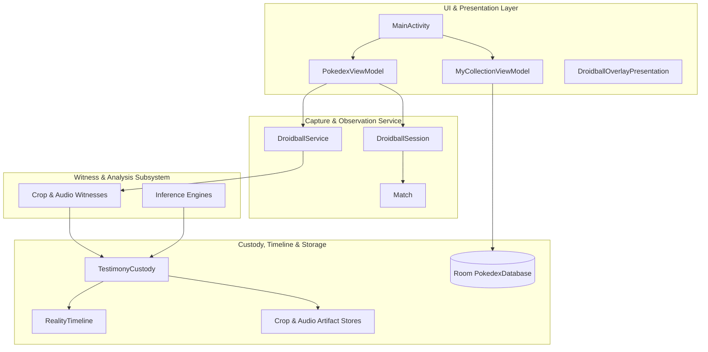

# Overdex Terminology Inventory & Code Map

> [!NOTE]
> **Overdex Architecture & Terminology Inventory**
> This document provides an exhaustive inventory of domain terms, architectural concepts, UI metaphors, key components, and vital functions across the Overdex codebase, paired with precise file references to locate them.

---

## 1. Domain Terminology & Glossary

| Term / Concept | Definition / Meaning in Overdex | Primary Code Location |
| :--- | :--- | :--- |
| **Captured Frame (`CapturedVisualFrame`)** | A raw screen frame containing a bitmap, wall timestamp, monotonic timestamp, and frame geometry. | [CapturedVisualFrame.kt](file:///home/sean/AndroidStudioProjects/Overdex/app/src/main/java/com/example/overdex/model/observation/CapturedVisualFrame.kt) |
| **Battle Region** | A spatial territory on the screen designated for observing a specific game element (e.g. Active HP Bar, Fast Move effectiveness text, Vs Screen). | [BattleCalibration.kt](file:///home/sean/AndroidStudioProjects/Overdex/app/src/main/java/com/example/overdex/data/BattleCalibration.kt) |
| **Calibrated Crop (`ResolvedBattleCrop`)** | A validated pixel rectangle extracted from a Captured Visual Frame according to a calibrated Battle Region. | [BattleCropContract.kt](file:///home/sean/AndroidStudioProjects/Overdex/app/src/main/java/com/example/overdex/battle/observation/BattleCropContract.kt) |
| **Witness** | An independent observer/sensor component that reads crops or audio PCM and produces exactly one typed signal (testimony). | [Observer.kt](file:///home/sean/AndroidStudioProjects/Overdex/app/src/main/java/com/example/overdex/battle/observation/Observer.kt) |
| **Testimony (`TestimonyRecord`)** | An immutable signal generated by a Witness, carrying structured evidence, timestamps, and SHA-256 artifact digests. | [TestimonyRecord.kt](file:///home/sean/AndroidStudioProjects/Overdex/app/src/main/java/com/example/overdex/battle/custody/TestimonyRecord.kt) |
| **Custody (`TestimonyCustody`)** | The immutable buffer and verification ledger that receives testimony and source-availability records without dropping bursts. | [TestimonyCustody.kt](file:///home/sean/AndroidStudioProjects/Overdex/app/src/main/java/com/example/overdex/battle/custody/TestimonyCustody.kt) |
| **Reality Article (`RealityArticle`)** | An immutable, timestamped record envelope representing an atomic unit of observed or inferred reality. | [RealityArticle.kt](file:///home/sean/AndroidStudioProjects/Overdex/app/src/main/java/com/example/overdex/battle/reality/RealityArticle.kt) |
| **Reality Timeline (`RealityTimeline`)** | The canonical sequential ledger of a match, compiling all Reality Articles into a coherent chronological timeline. | [RealityTimeline.kt](file:///home/sean/AndroidStudioProjects/Overdex/app/src/main/java/com/example/overdex/battle/reality/RealityTimeline.kt) |
| **Droidball Session (`DroidballSession`)** | A lifecycle scope surrounding zero or more battle attempts. Operates the overlay and media projection capture. | [DroidballSession.kt](file:///home/sean/AndroidStudioProjects/Overdex/app/src/main/java/com/example/overdex/battle/observation/DroidballSession.kt) |
| **Match (`Match`)** | The canonical record of an actual live or recorded battle session, publishing custody testimony to the Reality Timeline. | [Match.kt](file:///home/sean/AndroidStudioProjects/Overdex/app/src/main/java/com/example/overdex/battle/observation/Match.kt) |
| **Specimen (`OwnedPokemon`)** | An individual Pokémon instance owned by the trainer, possessing specific CP, moves, size, and team assignments. | [OwnedPokemon.kt](file:///home/sean/AndroidStudioProjects/Overdex/app/src/main/java/com/example/overdex/model/OwnedPokemon.kt) |
| **Registration Draft (`RegistrationDraft`)** | A persistent state accumulator holding OCR readings, crop evidence, and user confirmations during Pokémon registration. | [RegistrationDraft.kt](file:///home/sean/AndroidStudioProjects/Overdex/app/src/main/java/com/example/overdex/data/registration/RegistrationDraft.kt) |
| **Registration Assessment (`RegistrationAssessment`)** | An evaluation produced by `RegistrationEngine` detailing registration confidence, missing fields, and recommended action. | [RegistrationAssessment.kt](file:///home/sean/AndroidStudioProjects/Overdex/app/src/main/java/com/example/overdex/model/observation/RegistrationAssessment.kt) |
| **ODX-Fi Shell** | The physical hardware terminal layout wrapper surrounding screens, featuring retro CRT styling, D-Pad, and action buttons. | [ODXFiShell.kt](file:///home/sean/AndroidStudioProjects/Overdex/app/src/main/java/com/example/overdex/ui/ODXFi/ODXFiShell.kt) |
| **Match Archive (`MatchArchive`)** | A zipped `.odxmatch` package containing manifest JSON, reality articles, custody records, and content-addressed PNG/WAV artifacts. | [MatchArchive.kt](file:///home/sean/AndroidStudioProjects/Overdex/app/src/main/java/com/example/overdex/battle/archive/MatchArchive.kt) |

---

## 2. Project Component Breakdown

### A. Core UI & Presentation Components
* **`MainActivity.kt`** ([MainActivity.kt](file:///home/sean/AndroidStudioProjects/Overdex/app/src/main/java/com/example/overdex/MainActivity.kt))
  * *Role:* Entry Activity, Jetpack Navigation graph definition, and top-level ODX-Fi hardware shell binding.
* **`PokedexViewModel.kt`** ([PokedexViewModel.kt](file:///home/sean/AndroidStudioProjects/Overdex/app/src/main/java/com/example/overdex/ui/PokedexViewModel.kt))
  * *Role:* Application composition root for battle observation, service control, calibration management, and match export.
* **`MyCollectionViewModel.kt`** ([MyCollectionViewModel.kt](file:///home/sean/AndroidStudioProjects/Overdex/app/src/main/java/com/example/overdex/ui/MyCollectionViewModel.kt))
  * *Role:* Manager for owned Pokémon specimens, binder filters, team compositions, and active registration sessions.
* **`DroidballOverlayPresentation.kt`** ([DroidballOverlayPresentation.kt](file:///home/sean/AndroidStudioProjects/Overdex/app/src/main/java/com/example/overdex/battle/observation/DroidballOverlayPresentation.kt))
  * *Role:* Live overlay UI presenter displaying combatant health bars, energy state, active moves, and real-time battle HUD.

---

### B. Capture & Observation Engine
* **`DroidballService.kt`** ([DroidballService.kt](file:///home/sean/AndroidStudioProjects/Overdex/app/src/main/java/com/example/overdex/battle/observation/DroidballService.kt))
  * *Role:* Android Foreground Service handling `MediaProjection` screen recording, PCM audio capture, and registration frame throttling.
* **`DroidballSession.kt`** ([DroidballSession.kt](file:///home/sean/AndroidStudioProjects/Overdex/app/src/main/java/com/example/overdex/battle/observation/DroidballSession.kt))
  * *Role:* Coordinates session state around a potential match, managing lifecycle transitions between out-of-battle and active combat.
* **`Match.kt`** ([Match.kt](file:///home/sean/AndroidStudioProjects/Overdex/app/src/main/java/com/example/overdex/battle/observation/Match.kt))
  * *Role:* Canonical record of a single battle, wiring testimony from custody into the `RealityTimeline`.

---

### C. Witness & Observation Subsystem
* **`CropCaptureWitness.kt`** ([CropCaptureWitness.kt](file:///home/sean/AndroidStudioProjects/Overdex/app/src/main/java/com/example/overdex/battle/observation/CropCaptureWitness.kt))
  * *Role:* Captures and persists image crops before publishing `CropCaptured` testimony to custody.
* **`LiveActiveHpBarWitnesses.kt`** ([LiveActiveHpBarWitnesses.kt](file:///home/sean/AndroidStudioProjects/Overdex/app/src/main/java/com/example/overdex/battle/observation/LiveActiveHpBarWitnesses.kt))
  * *Role:* High-frequency color/pixel analysis witnesses measuring health bar percentages for active player and opponent Pokémon.
* **`PersistedOpponentBattleResourceWitness.kt`** ([PersistedOpponentBattleResourceWitness.kt](file:///home/sean/AndroidStudioProjects/Overdex/app/src/main/java/com/example/overdex/battle/observation/PersistedOpponentBattleResourceWitness.kt))
  * *Role:* Tracks opponent shield counts, switch timer availability, and remaining team count.
* **`OpponentPokemonFaintWitness.kt`** ([OpponentPokemonFaintWitness.kt](file:///home/sean/AndroidStudioProjects/Overdex/app/src/main/java/com/example/overdex/battle/observation/OpponentPokemonFaintWitness.kt))
  * *Role:* Detects opponent faint events and manages faint counter tracking.
* **`PokemonGoTypeIconMatcher.kt`** ([PokemonGoTypeIconMatcher.kt](file:///home/sean/AndroidStudioProjects/Overdex/app/src/main/java/com/example/overdex/battle/observation/PokemonGoTypeIconMatcher.kt))
  * *Role:* Template-matching classifier for identifying elemental type badges from captured crops.

---

### D. Inference & Accounting Engine
* **`FastMoveUseInference.kt`** ([FastMoveUseInference.kt](file:///home/sean/AndroidStudioProjects/Overdex/app/src/main/java/com/example/overdex/battle/inference/FastMoveUseInference.kt))
  * *Role:* Combines effectiveness text, audio pulses, and HP drops to infer fast move executions and cadence.
* **`FastMoveEnergyInference.kt`** ([FastMoveEnergyInference.kt](file:///home/sean/AndroidStudioProjects/Overdex/app/src/main/java/com/example/overdex/battle/inference/FastMoveEnergyInference.kt))
  * *Role:* Calculates energy accumulation per turn based on inferred fast move uses and move specs.
* **`ChargeMoveQteVibrationInference.kt`** ([ChargeMoveQteVibrationInference.kt](file:///home/sean/AndroidStudioProjects/Overdex/app/src/main/java/com/example/overdex/battle/inference/ChargeMoveQteVibrationInference.kt))
  * *Role:* Detects haptic vibration patterns corresponding to charged move mini-game interactions.
* **`ChargedMoveAnnouncementInference.kt`** ([ChargedMoveAnnouncementInference.kt](file:///home/sean/AndroidStudioProjects/Overdex/app/src/main/java/com/example/overdex/battle/inference/ChargedMoveAnnouncementInference.kt))
  * *Role:* Reads screen banner announcements when a charged move is launched.

---

### E. Custody, Timeline & Storage Infrastructure
* **`TestimonyCustody.kt`** ([TestimonyCustody.kt](file:///home/sean/AndroidStudioProjects/Overdex/app/src/main/java/com/example/overdex/battle/custody/TestimonyCustody.kt))
  * *Role:* Immutable event storage engine enforcing source availability tracking and testimony integrity.
* **`RealityTimeline.kt`** ([RealityTimeline.kt](file:///home/sean/AndroidStudioProjects/Overdex/app/src/main/java/com/example/overdex/battle/reality/RealityTimeline.kt))
  * *Role:* Timeline ledger holding chronological `RealityArticle` items and computing derived battle state.
* **`CropArtifactStore.kt`** ([CropArtifactStore.kt](file:///home/sean/AndroidStudioProjects/Overdex/app/src/main/java/com/example/overdex/battle/artifact/CropArtifactStore.kt)) & **`AudioArtifactStore.kt`** ([AudioArtifactStore.kt](file:///home/sean/AndroidStudioProjects/Overdex/app/src/main/java/com/example/overdex/battle/artifact/AudioArtifactStore.kt))
  * *Role:* Content-addressed storage saving crops and WAV audio files named strictly by SHA-256 hash digests.
* **`MatchArchiveExporter.kt`** ([MatchArchiveExporter.kt](file:///home/sean/AndroidStudioProjects/Overdex/app/src/main/java/com/example/overdex/battle/archive/MatchArchiveExporter.kt))
  * *Role:* Exports completed matches, custody records, timeline articles, and artifacts into compressed `.odxmatch` packages.

---

### F. Registration & Calibration Subsystems
* **`GuidedRegistrationController.kt`** ([GuidedRegistrationController.kt](file:///home/sean/AndroidStudioProjects/Overdex/app/src/main/java/com/example/overdex/data/registration/GuidedRegistrationController.kt))
  * *Role:* State machine for live overlay registration scans, field-by-field crop OCR, and cry recording.
* **`RegistrationEngine.kt`** ([RegistrationEngine.kt](file:///home/sean/AndroidStudioProjects/Overdex/app/src/main/java/com/example/overdex/data/observation/RegistrationEngine.kt))
  * *Role:* Evaluates observation evidence, resolves candidate species/candy families, and outputs registration confidence scores.
* **`CaptureTemplateManager.kt`** ([CaptureTemplateManager.kt](file:///home/sean/AndroidStudioProjects/Overdex/app/src/main/java/com/example/overdex/CaptureTemplateManager.kt))
  * *Role:* Manages device-specific registration crop box coordinates for detail page reading.
* **`MatchCalibrationProfileStore.kt`** ([MatchCalibrationProfileStore.kt](file:///home/sean/AndroidStudioProjects/Overdex/app/src/main/java/com/example/overdex/data/MatchCalibrationProfileStore.kt))
  * *Role:* Atomic profile store managing named device screen calibration parameters for battle regions.

---

## 3. Key Functions & Methods Map

| Function / Method Signature | Enclosing Class | File Path | Function Responsibility |
| :--- | :--- | :--- | :--- |
| `startObservation()` | `PokedexViewModel` | [PokedexViewModel.kt](file:///home/sean/AndroidStudioProjects/Overdex/app/src/main/java/com/example/overdex/ui/PokedexViewModel.kt#L380) | Initiates the screen capture media projection and starts `DroidballService`. |
| `assess(...)` | `RegistrationEngine` | [RegistrationEngine.kt](file:///home/sean/AndroidStudioProjects/Overdex/app/src/main/java/com/example/overdex/data/observation/RegistrationEngine.kt#L25) | Evaluates observation history, detects conflicts, and calculates registration confidence. |
| `buildSpecimen(...)` | `RegistrationSession` | [RegistrationSession.kt](file:///home/sean/AndroidStudioProjects/Overdex/app/src/main/java/com/example/overdex/model/RegistrationSession.kt#L45) | Resolves highest-confidence observations into a new `OwnedPokemon` specimen instance. |
| `publish(...)` | `Match` | [Match.kt](file:///home/sean/AndroidStudioProjects/Overdex/app/src/main/java/com/example/overdex/battle/observation/Match.kt#L80) | Converts raw testimony into a `RealityArticle` and publishes it to the `RealityTimeline`. |
| `record(...)` | `CropArtifactStore` | [CropArtifactStore.kt](file:///home/sean/AndroidStudioProjects/Overdex/app/src/main/java/com/example/overdex/battle/artifact/CropArtifactStore.kt#L20) | Encodes a crop bitmap to PNG, computes its SHA-256 digest, and writes it to disk. |
| `resolve(...)` | `BattleCropContract` | [BattleCropContract.kt](file:///home/sean/AndroidStudioProjects/Overdex/app/src/main/java/com/example/overdex/battle/observation/BattleCropContract.kt#L15) | Translates normalized battle region bounds into exact screen-pixel rectangle coordinates. |
| `infer(...)` | `FastMoveUseInference` | [FastMoveUseInference.kt](file:///home/sean/AndroidStudioProjects/Overdex/app/src/main/java/com/example/overdex/battle/inference/FastMoveUseInference.kt#L30) | Analyzes timeline signals to deduce fast move execution events. |
| `export(...)` | `MatchArchiveExporter` | [MatchArchiveExporter.kt](file:///home/sean/AndroidStudioProjects/Overdex/app/src/main/java/com/example/overdex/battle/archive/MatchArchiveExporter.kt#L25) | Packages match manifest, timeline, custody, and artifact stores into a ZIP file. |
| `addOwnedPokemon(...)` | `MyCollectionViewModel` | [MyCollectionViewModel.kt](file:///home/sean/AndroidStudioProjects/Overdex/app/src/main/java/com/example/overdex/ui/MyCollectionViewModel.kt#L91) | Inserts or updates an owned Pokémon record in the local Room database. |

---

## 4. Code Search & Navigation Guide

When searching for terms or extending components in Overdex, use these guidelines:

1. **Finding Witness Implementations:**
   * Look under `app/src/main/java/com/example/overdex/battle/observation/` for classes matching `*Witness.kt` or `*Observer.kt`.
2. **Finding Inferences & Calculations:**
   * Look under `app/src/main/java/com/example/overdex/battle/inference/` for classes ending in `*Inference.kt`.
3. **Finding Registration Logic:**
   * Look under `app/src/main/java/com/example/overdex/data/registration/` for state and readers (`GuidedRegistrationController`, `RegistrationDraft`, `DetailPageReader`).
4. **Finding UI Screens & Controls:**
   * Screens are housed in `app/src/main/java/com/example/overdex/ui/screens/`.
   * Shared retro/hardware UI components reside in `app/src/main/java/com/example/overdex/ui/components/` and `app/src/main/java/com/example/overdex/ui/ODXFi/`.
5. **Finding Database Models & DAOs:**
   * Room entities and DAOs are located in `app/src/main/java/com/example/overdex/data/local/` (`OwnedPokemonDao`, `PokemonDao`).
